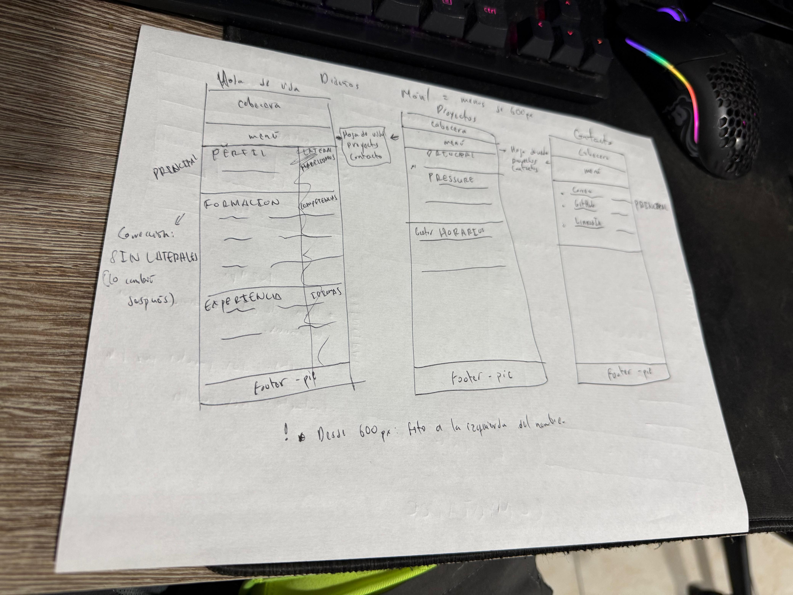
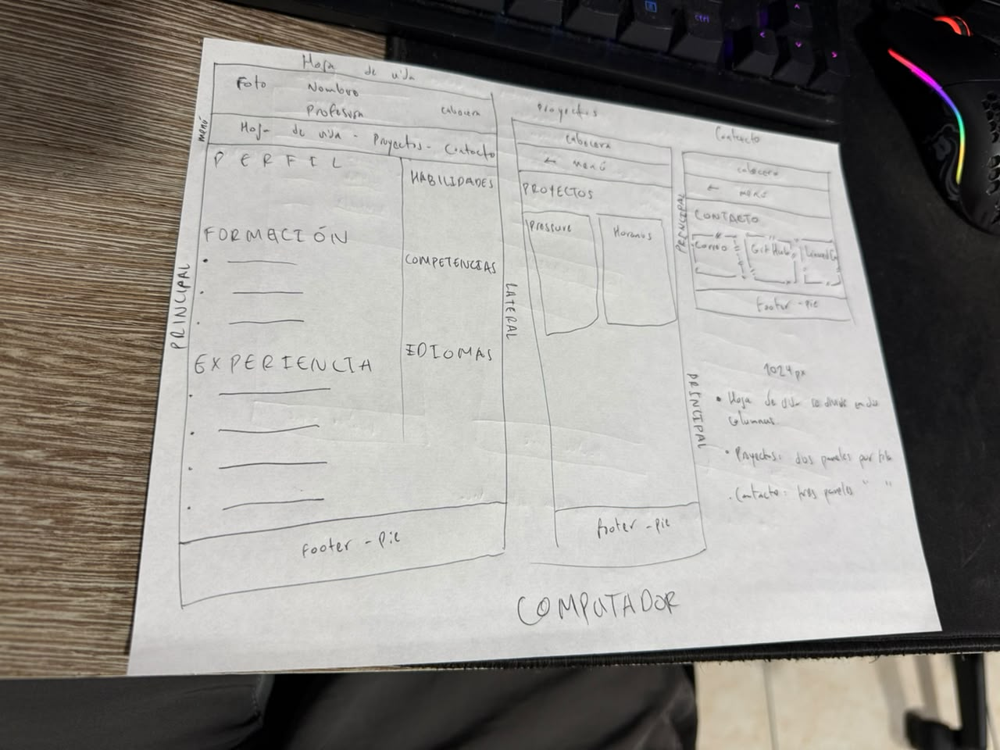
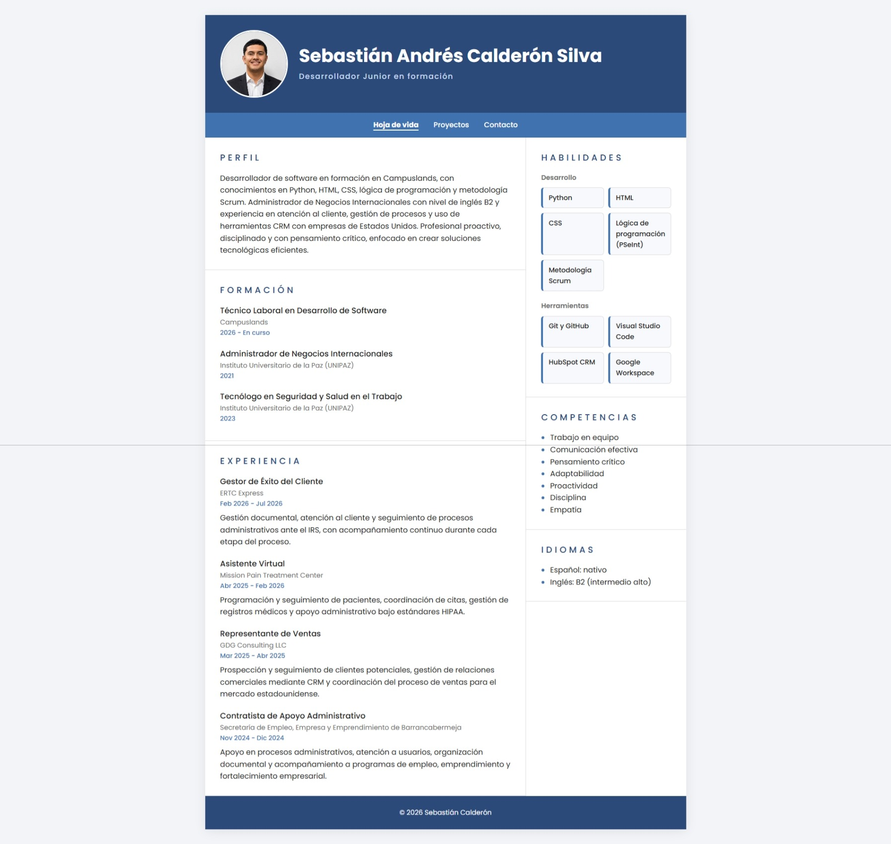
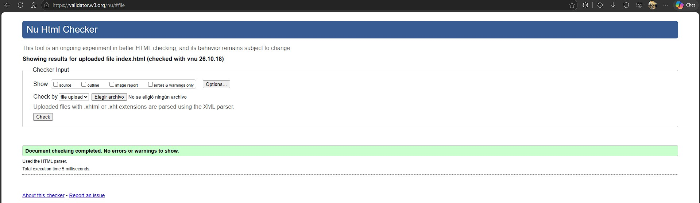

# Hoja de vida web · Sebastián Calderón

Sitio personal con mi hoja de vida como desarrollador de software junior en formación, mis proyectos y mis datos de contacto. Está construido con HTML y CSS, con diseño responsive (Mobile First) y publicado con GitHub Pages.

🔗 **Sitio publicado:** https://c4lde.github.io/hoja-de-vida/

## Páginas

| Página | Contenido |
|---|---|
| `index.html` | Hoja de vida: perfil, formación, experiencia, habilidades, competencias e idiomas |
| `proyectos.html` | Proyectos realizados en Campuslands, con enlace a cada repositorio |
| `contacto.html` | Correo, GitHub y LinkedIn |

## Mockups

### Celular

### Computador

## Capturas del sitio publicado

### Celular (dispositivo real)

### Computador

### Validación W3C

## Breakpoints

El CSS es Mobile First: los estilos base son para celular y las `@media (min-width: …)` están al final de `styles.css`.

- **Base (celular, menos de 600px):** todo va en una sola columna. La foto y el nombre van centrados, y las secciones laterales (habilidades, competencias, idiomas) quedan debajo de la experiencia.
- **Desde 600px (tablet):** la cabecera pasa a dos columnas, con la foto a la izquierda del nombre, y las secciones ganan más margen lateral.
- **Desde 1024px (computador):** la hoja de vida se divide en dos columnas con `grid-template-areas` (`principal` 2fr y `lateral` 1fr), y el sitio se ve como una hoja centrada con sombra.

Las tarjetas de habilidades, proyectos y contacto usan `repeat(auto-fit, minmax(…))`, así que se reacomodan solas según el ancho disponible, sin necesidad de breakpoints.

## Cómo lo publiqué

1. Creé un repositorio público en GitHub llamado `hoja-de-vida`. Lo dejé público para que cualquiera pueda ver el código y el sitio, y lo creé sin README porque lo iba a escribir después desde mi computador.
2. En la terminal de VS Code, dentro de la carpeta del proyecto, usé `git init` para convertir la carpeta en un repositorio de Git.
3. Subí el trabajo en varios commits con `git add` y `git commit`: primero la hoja de vida y el CSS, luego las páginas de proyectos y contacto, y por último los mockups y las capturas.
4. Conecté mi carpeta con el repositorio de GitHub con `git remote add origin` y subí los archivos con `git push -u origin main`.
5. En el repositorio entré a **Settings → Pages**. Al principio no me aparecía la opción para elegir la rama porque estaba en el Settings de mi perfil y no en el del repositorio. Tuve que entrar al repositorio y usar la pestaña **Settings** que está junto a *Code* e *Issues*. En **Source** elegí **Deploy from a branch**, la rama `main` y la carpeta `/ (root)`, porque ahí está mi `index.html`.
6. Después de 1 a 2 minutos apareció el enlace del sitio. Lo probé en una ventana de incógnito y desde mi celular, y revisé que funcionaran todas las páginas, los enlaces y las imágenes.

## Fuentes consultadas

**Publicación**
- [Crear un repositorio nuevo – GitHub Docs](https://docs.github.com/es/repositories/creating-and-managing-repositories/creating-a-new-repository)
- [Crear un sitio de GitHub Pages – GitHub Docs](https://docs.github.com/es/pages/getting-started-with-github-pages/creating-a-github-pages-site)
- [Configurar una fuente de publicación para GitHub Pages – GitHub Docs](https://docs.github.com/es/pages/getting-started-with-github-pages/configuring-a-publishing-source-for-your-github-pages-site)
- [Subir commits a un repositorio remoto – GitHub Docs](https://docs.github.com/es/get-started/using-git/pushing-commits-to-a-remote-repository)
- [Libro Pro Git en español](https://git-scm.com/book/es/v2)

**HTML y CSS**
- [grid-template-areas – MDN](https://developer.mozilla.org/es/docs/Web/CSS/grid-template-areas)
- [repeat() – MDN](https://developer.mozilla.org/es/docs/Web/CSS/repeat)
- [Uso de media queries – MDN](https://developer.mozilla.org/es/docs/Web/CSS/CSS_media_queries/Using_media_queries)
- [Etiqueta meta viewport – MDN](https://developer.mozilla.org/es/docs/Web/HTML/Viewport_meta_tag)
- [Validador HTML del W3C](https://validator.w3.org/)

**Apoyo**
- Claude (asistente de IA): apoyo para explicaciones de HTML y CSS, guía de pasos y revisión del código.
